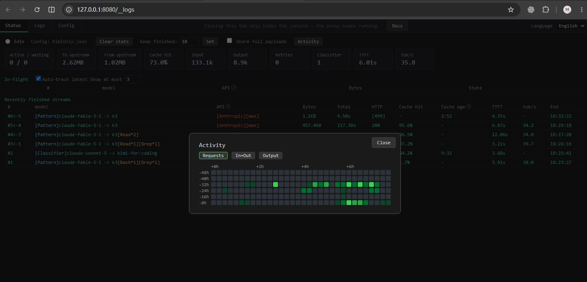
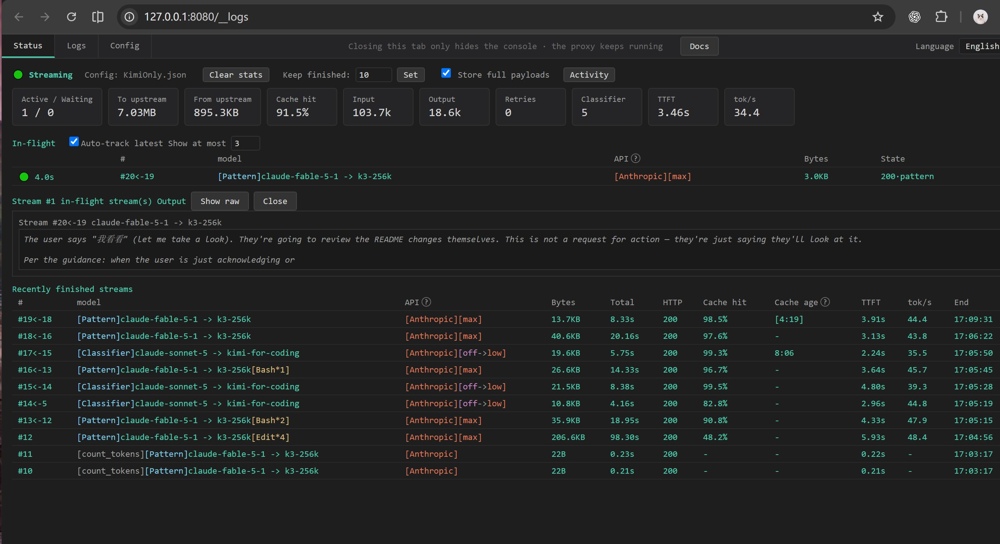
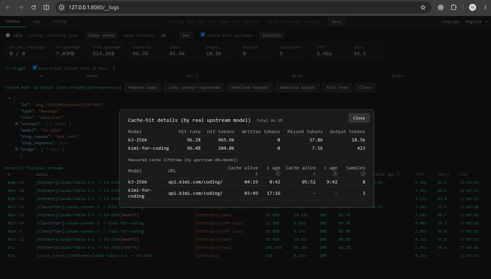
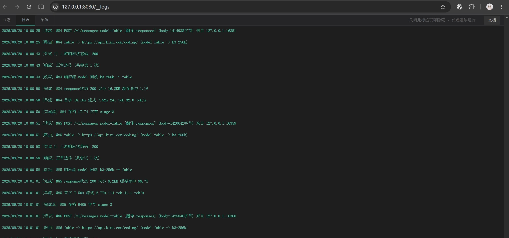
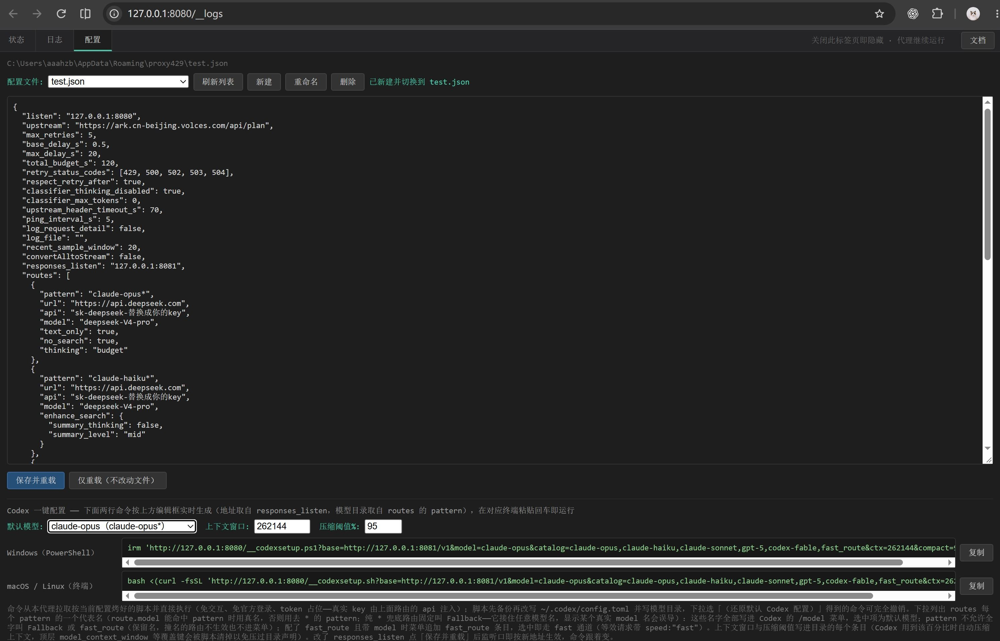

# Proxy429

**See What Your AI Agents Are Actually Doing.**  
**实时看见 AI Agent 正在做什么。**

Inspect live model requests and responses, explore captured payloads, and monitor token usage, cache hits, retries, and latency — all through a local web console.

实时查看模型请求与响应，检查捕获到的请求内容，并监控 Token、缓存命中、重试和延迟。

[English](#english) | [中文](#中文)

---

## English

Proxy429 is a local LLM API proxy for Claude Code, Codex CLI, and compatible OpenAI/Anthropic API clients. It helps requests recover from transient upstream failures — and gives you a live window into the traffic flowing between your agent and its model provider.

### Quick Start

1. **Download and launch** the release for your operating system. Proxy429 creates its configuration file on first launch.
2. **Configure your client** to use the local proxy:
   - Claude Code: `http://127.0.0.1:8080`
   - Codex CLI (Responses API): `http://127.0.0.1:8081`

   The console's configuration page can generate setup commands for Codex based on the current configuration.
3. **Inspect traffic** at `http://127.0.0.1:8080/__logs`.

For detailed setup and configuration, see the [Usage Guide](docs/usage.md).

### See what your agent sends and receives

Open the local console while your agent is working:

- **Inspect live streams:** watch in-flight output arrive in real time, rendered as readable text or raw SSE.
- **Explore full payloads:** inspect completed request and response bodies in an interactive JSON tree, with per-link-side views.
- **Examine model context:** review the captured payload sent upstream, including message content and other request fields present in the body.
- **Download for deeper debugging:** save request and output payloads for offline inspection.
- **Understand runtime behavior:** see token and byte counts, cache-hit rates, retries, first-token latency (TTFT), and throughput.
- **Review recent activity:** use the rolling 48-hour activity heatmap to see request, token, or output activity over time.

The console can help answer practical questions: What did the agent send to the model? What came back? How much context and output were involved? Did the request retry, hit cache, or take unusually long?

> **Subagent note:** Proxy429 exposes captured request/response payloads. Whether a payload belongs to a particular subagent, and how parent/child calls relate to one another, depends on the information available in the captured requests; do not treat this as automatic parent-child tracing unless that relationship is explicitly identifiable.

### More than an inspector: a resilient local proxy

- **Automatic retries:** exponential backoff for configured upstream status codes, including common 429 and 5xx failures, with support for rate-limit errors surfaced inside HTTP-200 SSE streams.
- **Flexible routing:** route model patterns to upstream providers and configure dedicated routes for supported request types such as classifier or fast-mode calls.
- **Protocol translation:** translate between OpenAI Responses and Anthropic Messages API formats, including tool calls and reasoning-mode mapping.
- **Cache visibility:** inspect cache-hit statistics by upstream model and review measured cache lifetimes.
- **Model remapping:** route a client-facing model name to a different upstream model and switch routes from the tray menu.
- **Search follow-ups:** in the protocol-translation path, search results can be carried in an encrypted response envelope for reuse by follow-up requests.
- **Thinking behavior:** configured thinking-mode handling can adapt requests and responses for supported upstreams.
- **Cross-platform tray app:** Windows, macOS, and Linux builds, with a bilingual Chinese/English web console.

See [Design and Architecture](docs/DESIGN.md) for implementation details and behavior.

### Download

Download prebuilt binaries from [GitHub Releases](https://github.com/aaahzb/proxy429/releases).

| Platform | Release asset |
|---|---|
| Windows x64 | `Proxy429-windows-x64.exe` |
| Linux x64 | `Proxy429-linux-x64.tar.gz` |
| macOS Apple Silicon (arm64) | `Proxy429-macOS-AppleSilicon-arm64.dmg` |

> [!WARNING]
> **macOS first launch:** Proxy429 is ad-hoc signed and is not notarized with an Apple Developer ID. Gatekeeper may block the first launch.
>
> - Open **System Settings → Privacy & Security**, find the Proxy429 message, choose **Open Anyway**, and confirm. On macOS 14 and earlier, right-clicking the app and choosing **Open** may also work.
> - Alternatively, remove the quarantine attribute in Terminal with `xattr -d com.apple.quarantine /Applications/Proxy429.app` (adjust the path if the app is installed elsewhere).
>
> The warning may return after an update replaces the app. On Windows, SmartScreen may also warn because the executable is unsigned; review the source and release before choosing **More info → Run anyway**.

### Screenshots

<strong>Stream viewer</strong> — inspect live streams and completed request/response bodies

<strong>Cache-hit details</strong> — review cache-hit rates and cache lifetimes

<strong>Request log</strong> — review routing, retries, and timing

<strong>Configuration</strong> — edit profiles and generate client setup commands

### Documentation

- [Usage Guide](docs/usage.md)
- [Windows Quick Start](docs/windows-quickstart.md)
- [Autostart Setup](docs/autostart-setup.md)
- [Design and Architecture](docs/DESIGN.md)

### Build from Source

Run `bash build.sh`. Build artifacts are written to `release/`.

### Motivation

I built Proxy429 after repeatedly hitting transient 429 throttling while using Claude Code with a GLM endpoint on Volcano Engine ARK. Manually reconnecting often let the work continue, which suggested that a patient retrying proxy could make these failures less disruptive.

Proxy429 is also built with AI coding agents: I define the problems and evaluate the results as a daily user, while the agents help implement the code.

### Acknowledgments

- [cc-switch](https://github.com/farion1231/cc-switch) (MIT, © 2025 Jason Young): parts of the Responses translation test suite are ported from its Rust tests; thinking-mode mapping follows cc-switch 3.20.0, and the `[cc-switch: omitted N bytes]` marker is retained for compatibility.

### Contributing

Issues and pull requests are welcome. When reporting a bug, include the stream ID shown in the console, so the captured request and response can be inspected.

### License

[MIT](LICENSE) © 2026 aaahzb

---

## 中文

Proxy429 是一个面向 Claude Code、Codex CLI 及兼容 OpenAI/Anthropic API 客户端的本地 LLM API 代理。它帮助请求从上游临时故障中恢复，并提供模型路由、协议翻译和实时网页控制台，方便查看请求流量。

### 快速上手

1. **下载并运行：** 从下方 Release 页面下载对应操作系统的版本。首次运行时，Proxy429 会自动生成配置文件。
2. **配置客户端**使用本地代理：
   - Claude Code：`http://127.0.0.1:8080`
   - Codex CLI（Responses API）：`http://127.0.0.1:8081`

   控制台的配置页面可以根据当前配置生成 Codex 设置命令。
3. **查看请求流量：** 打开 `http://127.0.0.1:8080/__logs`。

完整配置方法请参阅[使用指南](docs/usage.md)。

### 为什么使用 Proxy429？

- **临时故障自动重试：** 对 HTTP 429/5xx 进行指数退避重试，也能处理藏在 HTTP 200 SSE 流中的限流错误。
- **灵活的模型路由：** 支持跨提供商通配符路由，以及分类器、fast 模式专用路由和多模态或联网搜索兜底。
- **API 协议翻译：** 支持 OpenAI Responses ↔ Anthropic Messages，涵盖工具调用与思考模式映射。
- **实时查看请求：** 在网页控制台查看进行中的流、按链路侧检查请求/响应体，并追踪路由、重试、token 用量和缓存活动。
- **了解缓存表现：** 按上游模型查看缓存命中统计，并通过持续保存的 48 小时热图回顾近期活动。
- **模型名称映射：** 将客户端使用的模型名路由到指定的上游模型，也可以通过托盘菜单切换路由。
- **复用搜索结果：** 在协议翻译路径中，搜索结果可以通过加密响应信封传递，供后续请求复用。
- **调整思考模式：** 对明确关闭思考的请求，可转换为上游 low-thinking 请求，并从响应中移除思考块。

实现细节和行为说明见[设计与架构文档](docs/DESIGN.md)。

### 下载

各平台预编译版本见 [GitHub Releases](https://github.com/aaahzb/proxy429/releases)。

| 平台 | Release 文件 |
|---|---|
| Windows x64 | `Proxy429-windows-x64.exe` |
| Linux x64 | `Proxy429-linux-x64.tar.gz` |
| macOS Apple Silicon（arm64） | `Proxy429-macOS-AppleSilicon-arm64.dmg` |

> [!WARNING]
> **macOS 首次启动提示无法验证应用：** Proxy429 使用 ad-hoc 签名，没有 Apple Developer ID 证书，也未进行 Apple 公证，因此 Gatekeeper 可能拦截首次启动。
>
> - 打开**系统设置 → 隐私与安全性**，找到 Proxy429 的提示，点击**仍要打开**并确认。macOS 14 及更早版本也可以尝试右键应用并选择**打开**。
> - 或者在终端执行 `xattr -d com.apple.quarantine /Applications/Proxy429.app`（如果应用安装在其他位置，请调整路径）。
>
> 更新替换应用后，警告可能再次出现。Windows 版本也可能因可执行文件未签名而触发 SmartScreen；选择“更多信息 → 仍要运行”前，请先确认源码和 Release 的可信度。

### 截图

<strong>流查看器</strong> — 查看实时流与完整请求/响应体

<strong>缓存命中明细</strong> — 查看各上游模型的命中率和缓存存活时间

<strong>请求日志</strong> — 检查路由、重试和耗时

<strong>配置页面</strong> — 编辑配置并生成客户端设置命令

### 文档

- [使用指南](docs/usage.md)
- [Windows 快速上手](docs/windows-quickstart.md)
- [开机自启](docs/autostart-setup.md)
- [设计与架构](docs/DESIGN.md)（英文）

### 从源码构建

运行 `bash build.sh`，构建产物会输出到 `release/`。

### 项目缘起

我在火山引擎 ARK 的 GLM 端点上使用 Claude Code 时，经常遇到临时性的 429 限流。手动断开并重连往往就能继续工作，这让我意识到：一个能够耐心重试的代理，可以减少这类故障对工作流的干扰。

Proxy429 本身也是借助 AI 编程 Agent 开发的：我负责定义问题，并以日常重度用户的身份验收结果，Agent 协助完成代码实现。

### 致谢

- [cc-switch](https://github.com/farion1231/cc-switch)（MIT，© 2025 Jason Young）：部分 Responses 翻译测试移植自其 Rust 测试；思考模式映射参考 cc-switch 3.20.0，并为兼容性保留 `[cc-switch: omitted N bytes]` 标记。

### 参与贡献

欢迎提交 Issue 和 Pull Request。报 bug 时附上控制台里的流 ID，可直接查看捕获的请求与响应。

### 许可证

本项目采用 [MIT 许可证](LICENSE)，© 2026 aaahzb。
